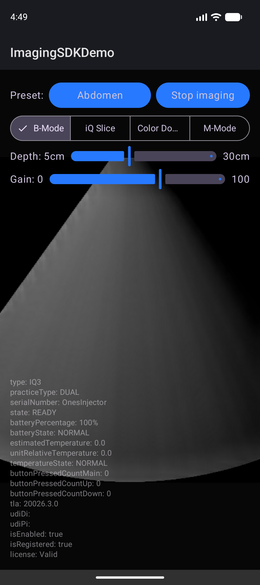

# Butterfly Imaging SDK (Developer Preview)

The Butterfly Imaging SDK allows you to quickly integrate Butterfly Network's imaging probes into your Android app, enabling you to:
* Read B-mode, Color Doppler, and M-Mode images from the Butterfly iQ probes.
* Change the preset, mode, depth, and gain of the Butterfly iQ probes.

The project also contains a sample app to demonstrate its usage and help you get started quickly.

## Description

The SDK consists of a few key objects:
* **`ButterflyImaging`** - The main object you use to initiate the SDK and control the probe. From here, you can start or stop imaging, and change presets, gain, depth, and mode. The status of the probe and images are read from this object via the `ImagingStateListener`, which is called whenever there is a new `ImagingState` available.
* **`ImagingState`** - With every change in the state of the probe, you receive a new imaging state (via the `ImagingStateListener` set on the `ButterflyImaging` object). This includes access to scanned images, imaging settings, probe state, battery status, etc.
* **`ButterflyImage`** - Within the `ImagingState` object, the `bModeImage` and `mModeImage` properties represent the latest image/frame from the probe. These include the image data (as an Android `Bitmap`) and metadata.
* **`ImagingPreset`** - Every imaging session is set with an Imaging Preset, a predefined set of imaging parameter values for different clinical procedures such as Abdomen, Bladder, Cardiac, etc.
* **`UltrasoundMode`** - The different imaging modes supported in the SDK: B-Mode, Color Doppler, M-Mode, Multi-Slice, AutoFan, and Biplane.

## Requirements

* Built and tested using Android Gradle Plugin 9.2.1 and JDK 21.
* Apps developed using the SDK should only be installed on [Butterfly supported devices](https://support.butterflynetwork.com/s/article/16907171799451-Devices-Compatible-With-Butterfly-iQ-iQ-iQ3).
* Available for Android 13 (API level 33) or newer.
* Architecture: ARM64-v8a.
* A physical device is needed for testing with a real probe.
* An emulator with an ARM64-v8a system image above version 36.1 is supported for testing.
* Internet connectivity is required for the initial setup of the SDK on a device, for periodic validation every 30 days.
* The SDK does not save images collected by your app.

## Installation

To start using the SDK, please follow these steps:

1. Add your [Butterfly Access Token](docs/AccessToken.md) to your machine.
1. In your project's `settings.gradle.kts`, add the local Maven repository (where the SDK is installed):
   ```kotlin
   dependencyResolutionManagement {
       repositories {
           google()
           mavenCentral()
           mavenLocal()
       }
   }
   ```
1. Apply the Butterfly Imaging SDK loader plugin in your app module's `build.gradle.kts`:
   ```kotlin
   plugins {
       id("com.butterflynetwork.sdk.plugin.loader") version "<version>"
   }
   ```
1. Sync and build your project.

## Troubleshooting

If you encounter any issues during the integration of the SDK, please refer to the [Troubleshoot](docs/Troubleshoot.md) page.

## Quick Start

1. **Configure USB probe detection.** Add the following intent filter to your main activity's `<activity>` tag in `AndroidManifest.xml`. This allows your app to automatically launch when a Butterfly probe is connected:

   ```xml
   <intent-filter>
       <action android:name="bni.intent.action.PROBE_ATTACH" />
       <category android:name="android.intent.category.DEFAULT" />
   </intent-filter>
   ```

2. **Set up imaging.** Here is a brief guide to quickly get started with the SDK. Follow these five key steps:

   1. Set up the listener.
   1. Initialize the SDK with your client key.
   1. Establish a connection.
   1. Start the imaging session.
   1. Display the results.

   ```kotlin
   class MyActivity : ComponentActivity() {

       private val imaging: ButterflyImaging by lazy {
           ButterflyImaging.getSharedInstance(this)
       }
       private var didStart = false

       // A dedicated single thread for all imaging operations is recommended.
       private val imagingExecutor by lazy {
           Executors.newSingleThreadExecutor { runnable ->
               Thread(runnable, "ImagingThread")
           }
       }

       // Dedicated dispatcher that uses the imaging thread.
       private val imagingDispatcher: CoroutineDispatcher by lazy {
           imagingExecutor.asCoroutineDispatcher()
       }

       override fun onCreate(savedInstanceState: Bundle?) {
           super.onCreate(savedInstanceState)

           // 1. Set up listener to handle state changes.
           imaging.imagingStateListener = object : ImagingStateListener {
               override fun onImagingStateChange(
                   imagingState: ImagingState,
                   imagingStateChanges: ImagingStateChanges,
               ) {
                   if (didStart) return
                   didStart = true

                   lifecycleScope.launch(imagingDispatcher) {
                       // 3. Connect the simulated probe.
                       imaging.connectSimulatedProbe()

                       // 4. Start imaging.
                       imaging.startImaging()
                   }

                   // 5. Present image.
                   if (imagingStateChanges.bModeImageChanged) {
                       val bitmap = imagingState.bModeImage?.image
                   }
               }
           }

           // 2. Start the SDK with your client key.
           lifecycleScope.launch(imagingDispatcher) {
               imaging.startup(clientKey = "CLIENT KEY")
           }
       }
   }
   ```

> [!NOTE]
> Running all imaging operations on a single dedicated thread is recommended. See the [sample app](demo) for an example using a dedicated coroutine dispatcher.
>
> When using a physical probe instead of the simulated one, ensure the probe is ready and presets are available before calling `startImaging` by checking: `state.probe.state == ProbeState.READY && state.availablePresets.isNotEmpty()`. The connection is established automatically by plugging the probe into your Android device.

## Sample App

Explore more advanced usage via the [demo app](demo). It showcases the setup described above, a basic workflow for starting the SDK, reading images, and controlling the probe's capabilities.

To run the sample app:

1. Make sure you have followed our [instructions](docs/AccessToken.md) for adding your Butterfly Access Token to your machine.
1. Add your client key to the **root project**'s `local.properties`:

   ```properties
   sdkClientKey=[CLIENT KEY]
   ```

1. Build and run the `demo` module.

      

      And you should be good to go!

## License

Copyright 2012-2026 (C) Butterfly Network, Inc.

_**Disclaimer -- The Butterfly Imaging SDK and Sample App are not medical devices and are not intended to be used in the diagnosis, prevention, or treatment of diseases or medical conditions.**_
